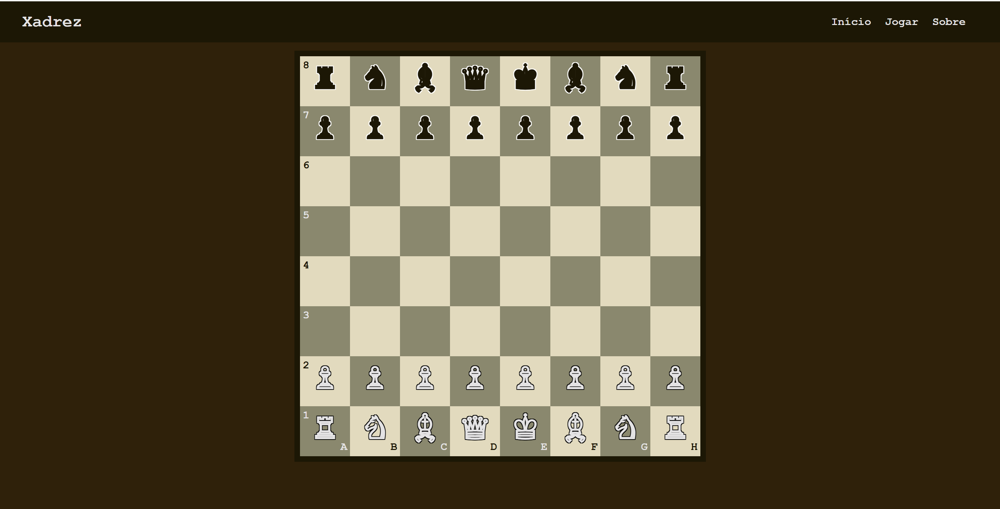

# ♟️ Chess Web (HTML, CSS & JavaScript)

Jogo de xadrez interativo desenvolvido com **HTML**, **CSS** e **JavaScript puro** , jogável diretamente no navegador.

## 📋 Sobre o projeto

Versão web do clássico jogo de xadrez, com tabuleiro visual, interação via clique/drag-and-drop nas peças e validação de movimentos em tempo real.

## 🚀 Funcionalidades

- [x] Tabuleiro 8x8 renderizado em HTML/CSS
- [x] Movimentação das peças via clique ou arrastar (drag and drop)
- [ ] Validação de movimentos válidos por tipo de peça
- [ ] Destaque de casas possíveis ao selecionar uma peça
- [ ] Detecção de xeque e xeque-mate
- [ ] Histórico de jogadas
- [ ] Design responsivo

> Marque os itens conforme forem implementados.

## 🛠️ Tecnologias

- HTML5
- CSS3
- JavaScript 

## ▶️ Como executar

Basta abrir o arquivo `index.html` no navegador, ou:

```bash
git clone https://github.com/isaxavierz/chess-web.git
cd chess-web
# abra o index.html no navegador
```

Ou, se preferir rodar um servidor local:

```bash
npx serve .
```

## 📁 Estrutura do projeto

```
chess-web/
├── index.html      # Estrutura da página, estilização e lógica do jogo
└── README.md
```

## 🎯 Objetivo de aprendizado

- Manipulação do DOM com JavaScript puro
- Lógica de jogos aplicada ao front-end
- Estilização de tabuleiros e elementos interativos com CSS

## 🖼️ Demonstração


## 📄 Licença

Este projeto está sob a licença MIT. Sinta-se à vontade para usar e modificar.

## 👤 Autor

Feito por [Isabelly Xavier](https://github.com/isaxavierz)